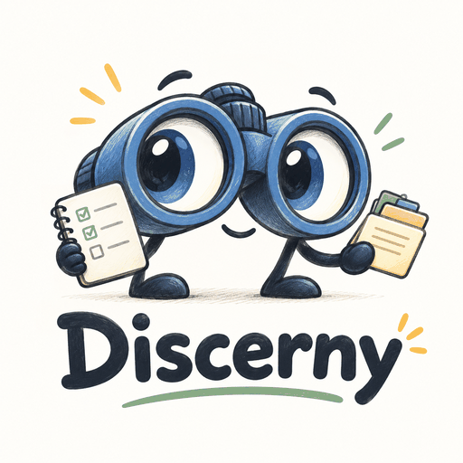

<p align="center">
  
</p>

# Discerny

Discerny is a task tracker and knowledge base for the work you're juggling and the people, projects and systems around it. It borrows from David Allen's *Getting Things Done*, and you run it together with an AI agent.

Everything lives in a folder of plain Markdown files on your own computer, kept apart from the app itself. You work on those files through a local web page. Your AI agent works on the same files directly: it fills your inbox from mail and chat, carries out the requests you leave it, and keeps records of people and systems up to date. Neither of you owns the data; the files do.

## How it works

- **The files are the source of truth.** `TASKS.md`, `PEOPLE.md`, `PROJECTS.md`, `SYSTEMS.md` and a few others hold everything in a simple, readable format. You can open them in any text editor.
- **The app and your data are separate folders.** The app folder (this one) holds the UI, the instructions, the helper and the skills. Your data folder holds only your files and can live anywhere. The app works on whichever data folder you connect it to: your own, or one for trying things out. You can replace the app with a newer version without touching your data.
- **The UI is a local web page.** Open `discerny.html` in Chrome or Edge and choose your data folder, or run `node tools/discern.mjs serve` and open the page in any browser. Either way the page reads and saves the files in place. Nothing is uploaded anywhere.
- **Your agent follows `AGENTS.md`.** That file tells any AI agent how the files are laid out and the rules for changing them. Point your agent at it and it can work alongside you.
- **You talk to your agent through the files.** Every item in the UI has an *Agent* tab, and every person, project and system page has an *Ask agent* button. What you write there is an agent request. Requests wait in the agent queue, `ASK-AGENT.md`, and the agent works through them the next time you run the `discern-ask-agent` skill. The *Agent* page shows the queue and the drafts waiting for you.

How the GTD steps map onto Discerny:

| GTD step | In Discerny |
|---|---|
| Capture | Source skills read your mail, chat or other sources and propose new items into `INBOX.md` |
| Clarify | You clarify each proposal in the UI's inbox: correct it if need be, then accept or dismiss it |
| Organise | Items carry a type, urgency, person, project and tags; people, projects and systems have their own records, with relationships between them |
| Reflect | Weekly review page |
| Engage | Today, Next actions, Waiting for and Upcoming views, and an All items page that groups, sorts and searches everything open |

## Works with any agent and any connector

Discerny never connects to your mail, chat or calendar itself. Your agent does that, through whatever connectors it has (an Outlook or Gmail connector, an MCP server, an exported file), and writes what it finds into the inbox. Any agent that can read and edit files in your data folder and follow `AGENTS.md` can work with Discerny.

Every source skill follows the same rules, in `SOURCE-SKILLS.md`, and uses the same helper, `tools/discern.mjs`, for the fiddly parts: new IDs, time zones, spotting duplicates and editing the files. The helper needs [Node.js](https://nodejs.org) 18 or later.

## Skills included

Discerny comes with ready-made skills for Claude in `.claude/skills/` (a hidden folder). Use them as they are, adapt them, or write your own (see below).

| Skill | What it does |
|---|---|
| `discern-outlook-mail` | New Outlook mail, and sent mail still waiting for a reply or recording a promise, into your inbox |
| `discern-teams` | Teams messages that mention or are addressed to you, files shared with you, your own commitments and unanswered asks, and watched channels |
| `discern-outlook-calendar` | Every meeting in the coming days, straight into your open items and kept in step when it moves or is cancelled; prep items and unanswered invites into your inbox; overlaps; optionally action items from transcripts |
| `discern-refresh` | A refresh: runs every source skill that has a block in `SOURCES.md`, one after another |
| `discern-ask-agent` | Works through the agent requests you leave in the UI |
| `discern-upgrade` | Upgrades a data folder in an older Format, showing you each change before making it |

The three Microsoft 365 skills need Claude's Microsoft 365 connector. They only read: they never send, move or mark anything.

- **Claude Code** picks the skills up by itself when you start it in the app folder. Give it your data folder as well: `claude --add-dir <your data folder>`. Skills in your personal `~/.claude/skills/` folder win over these when the names match, so remove any older copies there.
- **A Claude project with both folders connected** (the app folder and your data folder): zip each folder in `.claude/skills/` and add it as a skill in your Claude account. Account skills also load in Claude Code when you're signed in, so after changing a skill, update the account copy too.

On its first run, a source has no block in `SOURCES.md` yet, so its skill asks how far back to start and creates one. Set your time zone in the `## defaults` block of `SOURCES.md` before then.

`tools/evals/` holds recorded connector responses and the results each skill should produce from them, so a skill can be tested without the connector; its `README.md` explains how.

## Getting started

1. **Get the app.** Clone this repository (`git clone https://github.com/StormSleeper/discerny-app.git`), or download it as a zip and unzip it, for example to `~/discerny-app`. This is the app folder. Your data goes in a folder of its own.
2. **Make your data folder.** In the app folder, run `node tools/discern.mjs new ~/discerny-data` (any new or empty folder will do). It copies the blank starter files from `new_discerny_repo` and connects the app to the copy. Without Node, copy the `new_discerny_repo` folder somewhere private yourself. If you keep your data in git, use a private repository.
3. **Open the UI.** Open `discerny.html` in Chrome or Edge, click to choose a folder, and pick your data folder. Allow the browser to edit files when it asks. To switch to another data folder later, use *Change folder* at the bottom of the sidebar. To use another browser, or to skip choosing the folder, serve the page instead, as the next section says.

### Serving the UI from the helper

In the app folder, run `node tools/discern.mjs serve`. It prints an address such as `http://127.0.0.1:4790/`: open it in any browser, Firefox and Safari included, and the page opens straight on your connected data folder, with no folder to choose and nothing to allow. Leave the command running while you use the page, and stop it with Ctrl C. If the page says the server isn't running, start it again and click *Retry*; nothing you changed on screen is lost.

The server answers only this computer (127.0.0.1), and only for the files the page itself uses. `--port <n>` picks another port, and `--dir <folder>` serves a different data folder without changing the connected one.

To switch folders, use *Change folder* in the page: type the folder's path, or pick a suggestion, and the page reopens on it. The server connects to the new folder as `connect` does, so your agent works on it too. You can start `serve` before any folder is connected, or on a folder that needs an upgrade: the page says what's wrong and offers *Change folder*. A server started with `--dir` keeps to that folder; to switch, stop it, run `node tools/discern.mjs connect <folder>`, and start it again.

In Chrome or Edge, the served page can be installed as an app, with its own window and a Discerny icon on the taskbar and in the Start menu: use *Install Discerny* in the browser's menu or address bar. The installed app is the same page, so it works only while `serve` is running, on the default port.

Serve the page when you want a browser other than Chrome or Edge, or when your agent should open the UI itself. Opening the file needs no Node and works the same in Chrome and Edge.
4. **Work through the starter project.** Your data folder starts with one project, *Discerny Setup*, and three items:
   - T-0001: connect your agent to your data folder. For Claude Code, that means starting it in the app folder with `claude --add-dir ~/discerny-data`.
   - T-0002: set up the `discern-ask-agent` skill. Claude Code already has it; the task says how to add it to a Claude project, and has a prompt to paste in for any other agent.
   - T-0003: run the skill once. It finds a request waiting on your own record (P-0001) and asks for your name.

### Try it on the Example first

[discerny-example](https://github.com/StormSleeper/discerny-example), the Example, is a ready-made data folder for a fictional company, Pennywhistle Puppet Works, with a few weeks of tasks, meetings, people, projects and systems already in it. It is the quickest way to see what Discerny looks like in use. Clone it beside the app folder (`git clone https://github.com/StormSleeper/discerny-example.git`), then choose that folder in the UI, or run `node tools/discern.mjs connect ../discerny-example` in the app folder. Its README says how to put it back after you've changed it.

You can have more than one data folder, for example one to try things out in. Switch the UI with *Change folder*, and your agent with `node tools/discern.mjs connect <folder>` in the app folder, which records it as `data_folder` in `config.toml` there; `node tools/discern.mjs connect` on its own shows which folder is connected.

## What's in the folders

### Your data folder

| File | What it is |
|---|---|
| `TASKS.md` | Your open items: tasks, meetings, processes, documents and FYIs |
| `INBOX.md` | Proposals for new items from source skills, waiting for you to clarify them |
| `DONE.md` | Completed items |
| `PEOPLE.md`, `PROJECTS.md`, `SYSTEMS.md` | One record each for the people, projects and systems you deal with |
| `RELATIONSHIPS.md` | Relationships between items and records, such as which task concerns which system |
| `REFERENCE.md` | Web addresses, people's details and other things you look up often |
| `ASK-AGENT.md`, `ASK-AGENT-LOG.md` | The agent queue: requests waiting for your agent, and a record of what it did with them |
| `SOURCES.md`, `IGNORED.md` | Bookkeeping for source skills: shared settings such as your time zone, how far each source has been read, and what was ignored or dismissed, so it's never proposed again |
| `REFRESH-LOG.md` | A record of each source-skill run, created on the first run |
| `drafts/` | Messages your agent drafted for you. They are never sent |

### The app folder

| File | What it is |
|---|---|
| `discerny.html` | The UI |
| `AGENTS.md` | Instructions for AI agents (`CLAUDE.md` points Claude to it) |
| `SOURCE-SKILLS.md` | The rules every source skill follows |
| `.claude/skills/` | The Discerny skills for Claude (a hidden folder) |
| `tools/` | `discern.mjs`, the helper: it connects the app to a data folder (`connect`, `new`), serves the UI in any browser (`serve`), upgrades one written by an older app (`upgrade`) and does the fiddly parts for source skills. Also its tests (`node --test tools/test/discern.test.mjs`) and `evals/`, recorded connector responses for testing the skills. Both run on a copy of the Example, a fictional company called Pennywhistle Puppet Works: [discerny-example](https://github.com/StormSleeper/discerny-example), cloned beside the app folder and read as of its last commit, or the folder named in `DISCERNY_TEST_DATA` |
| `migrations/` | One folder per change to the way a data folder is written, which `discern upgrade` runs in order. Its `README.md` is for whoever writes one |
| `new_discerny_repo/` | The blank starter files a new data folder is copied from |
| `config.toml` | The app folder's settings. `data_folder` says where your data folder is, so your agent and the skills can find it; `discern connect` and `discern new` write it, and leave the rest of the file as you wrote it |

`discerny.html` is the UI: Today, Inbox, Next actions, Waiting for, Upcoming, FYI, All items, Projects, People, Systems, Weekly review, Done and an Agent page, with search (Ctrl K), undo and dark mode.

### Version

The UI shows the app's version on the folder page, and `node tools/discern.mjs --version` prints it. A version has four numbers, `MAJOR.MINOR.PATCH.BUILD`:

- **MAJOR** goes up for a big change to the app.
- **MINOR** goes up when the way your data folder is written changes.
- **PATCH** goes up with the first change after each release.
- **BUILD** goes up with every change, and never goes back down.

If the first two numbers differ from the last release you had, your data folders need an Upgrade before the new app will work on them. Ask your agent to "upgrade my Discerny folder", or run `node tools/discern.mjs upgrade` to see what it would change and `node tools/discern.mjs upgrade --write` to make the changes. Either way, a copy of the folder is first made beside it, named `<folder>.backup-<format>`. If only the last two differ, just pull.

The `main` branch holds only releases, and each one is tagged `v<version>`, such as `v0.1.1.1`. The `dev` branch holds every change as it's made, each with its own build number. Stay on `main` unless you want to try changes before they're released. Each version number is set when a change is made, never by hand. `CHANGELOG.md` says what each release changed.

## Writing your own skills

A Discerny skill is a set of instructions your agent runs on request, such as "check my mail for new items" or "chase everything I've been waiting on for more than a week". Name them `discern-<name>`.

The easiest way to write one is to ask your agent to write it. Point it at `AGENTS.md`, which already contains the file formats and the rules every skill must follow, and describe what you want. A good prompt says:

- what the skill should do, and when you'll run it;
- where its information comes from: which connector, tool or file;
- what it should write, and where;
- that you want to see it working on a few real items, without writing anything, before it's saved.

### Prompt for a source skill

Use this for a skill that brings new items into your inbox.

```
Read AGENTS.md and SOURCE-SKILLS.md in my Discerny app folder.

Then write a skill called discern-<source>, for example discern-gmail, that
reads <the source: for example "my Gmail inbox, through the Gmail connector">
and proposes new items into INBOX.md.

- Treat as actionable: <for example "requests addressed to me, meeting
  invitations, and anything with a due date">.
- Treat as noise: <for example "newsletters, automatic replies, notifications
  from no-reply addresses">.
- Use "<source-name>" as its block name in SOURCES.md and create the block
  on the first run, with a watermark of <how far back to start, for example
  "7 days ago">.

Follow the headings and the helper commands SOURCE-SKILLS.md describes, and
keep the skill short: it should read AGENTS.md and SOURCE-SKILLS.md each time
it runs rather than copying the file formats. Before saving it, do a dry run against the last
<10> items and show me what it would add to the inbox, without writing
anything.
```

### Prompt for any other skill

Use this for a skill that works on the files themselves, such as a weekly review or a chaser for overdue items.

```
Read AGENTS.md in my Discerny app folder, especially "Rules for every edit" and
"Writing a skill for Discerny".

Then write a skill called discern-<name> that <what it does, for example
"finds every item with st:Waiting that is more than 7 days old and writes a
polite chaser for each one in drafts/">.

It should change only <which files>, and never send anything. Keep the skill
short: it should read AGENTS.md each time it runs rather than copying the
file formats. Show me the skill, and what it would do with my current files,
before you save it.
```

Save a skill for Claude in the app folder, as `.claude/skills/discern-<name>/SKILL.md`, beside the others. To try a new skill safely, make a data folder for testing with `node tools/discern.mjs new <folder>`, or copy a data folder you already have and run `node tools/discern.mjs connect <copy>`. Run the skill against it, then `node tools/discern.mjs connect <your data folder>` to switch back.

## Licence

Discerny is source-available under the MIT License with the Commons Clause (see `LICENSE`). You may use, copy, change and share it, for personal use or inside a business, provided the original author, Gareth Henry, is credited. You may not sell it, or sell a product or service whose value comes mainly from it.
